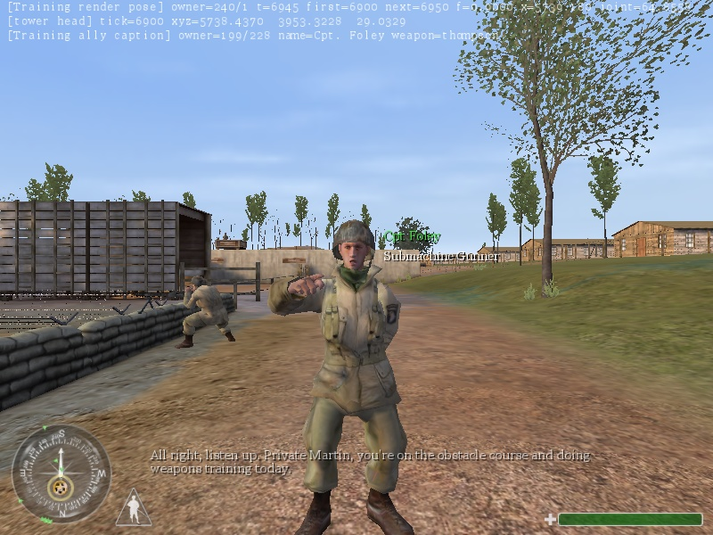

# CODPORT-SP

[Русский](README.md) · [Download 196C for Windows](https://github.com/QuistBit/CODPORT-SP/releases/tag/196C)

CODPORT-SP brings the single-player **Call of Duty (2003)** to the **Return to Castle Wolfenstein: Single Player** engine. Version **196C** focuses on the Training mission at Camp Toccoa. The port reads maps, GSC mission scripts, animations and audio from your original game installation.



## Play Training

1. Install the original Call of Duty (2003) on Windows. Its installation folder must contain `CoDSP.exe` and `main\pak0.pk3`.
2. Download **CODPORT-SP-196C-Windows-x86.zip** from the release page. Extract the complete archive into a separate writable folder.
3. Double-click **Play-Training.cmd** and select the original game's **CoDSP.exe**. Click the diary to begin. The 32-bit port runs in a window and stores its settings and log in `profile\main`.

## What has been tested

| Training sequence | Result in 196C |
| --- | --- |
| Diary and intro | Camp Toccoa, the date and the time appear after the diary closes. The music starts on the first visible black frame of the intro. |
| Obstacle course | Cline steers around a prone player at the pipe entrance. In a second test, a player placed inside the moving soldier could crawl free. |
| Actors | The client interpolates poses between server updates. Allies can appear on the compass. Aiming at Foley or Cline shows rank, name and weapon class. |
| Jump tower and range | Paratroopers keep jumping until the carbine is picked up. A weapon exchanged at a rack takes the position and display scale of the weapon just picked up. |
| Mission ending | An automated run reached the victory menu using player input and repositioning between exercises. |

Checkpoints do not yet restore GSC threads and mission state. A Training adapter starts the original mission tasks and clears the breached wall's collision after the explosion. The rest of the campaign, the transition to the next map and alternate routes through Training still need verification.

## Build from source

Open an **x86 Native Tools Command Prompt for Visual Studio** with MSVC, the Windows SDK and Python 3 available. From the repository root, run:

```bat
python tools\build_windows.py
```

This builds `WolfSP.exe`, `qagamex86.dll`, `cgamex86.dll` and `uix86.dll` in `build\bin` and packs the Training adapter in `build\profile\main\training.pk3`. Put the **32-bit** `soft_oal.dll` beside the executable. The prebuilt release includes it. Version 196C was tested with [OpenAL Soft 1.25.2](https://github.com/kcat/openal-soft/releases/tag/1.25.2).

```bat
python tools\run_training.py --game "C:\Games\Call of Duty"
```

For another build directory, pass `--output` when building and `--build` when launching.

The [game module](src/game) contains actor movement, weapon handling and the [GSC runtime](src/game/cod1_gsc). The [client game module](src/cgame) handles poses, HUD elements and the compass. The [Training entry script](main/scripts/gsc_tests/r234_training_turret.gsc) starts the mission.

Based on [id Software's RTCW-SP source release](https://github.com/id-Software/RTCW-SP). The engine license and third-party notices are in [COPYING.txt](COPYING.txt) and [README.txt](README.txt).
