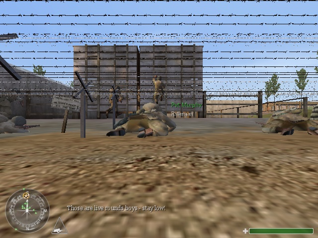

# CODPORT-SP

[English](README.en.md) · [Скачать 724A для Windows](https://github.com/QuistBit/CODPORT-SP/releases/tag/724A) · [Дневник разработки Training](docs/devlog/training.md)

Порт одиночной **Call of Duty (2003)** на движок **Return to Castle Wolfenstein: Single Player**. Сборка **724A** посвящена учебной миссии в Кэмп-Токкоа. Движок читает карту, сценарии GSC, анимации и звук из вашей установки Call of Duty.



## Как запустить

1. Установите оригинальную **Call of Duty (2003)** для Windows. В её папке должны быть `CoDSP.exe` и `main\pak0.pk3`.
2. Скачайте **CODPORT-SP-724A-Windows-x86.zip** со страницы релиза и распакуйте архив целиком в отдельную папку, доступную для записи.
3. Откройте **Play-Training.cmd** и выберите `CoDSP.exe` из установленной игры. В главном меню начните новую игру, выберите сложность и щёлкните по странице дневника, чтобы войти в миссию.

Порт запускается в окне. Настройки и журнал `rtcwconsole.log` сохраняются в `profile\main` рядом с распакованной сборкой. Папку установленной игры можно передать напрямую в командной строке.

```bat
Play-Training.cmd "C:\Games\Call of Duty"
```

## Что изменилось в Training

Курсанты перемахивают через забор, ползут под проволокой, встают на выходе и бегут к лестнице. У подножия каждый начинает подъём по перекладинам. Пока группа ползёт, капитан Фоули идёт рядом и следит за ней. Дневник открывается в тишине, а шум лагеря слышен уже на уровне и остаётся после вступительной музыки.

Учебная карта загружается быстрее. В двух обычных прохождениях до первого М1 при 1280 × 800 средняя частота составила 55,5 и 56,7 кадра/с. У проволоки она опускалась в среднем до 52–55 кадров/с. Подробные результаты и кадр с полосы препятствий есть в [дневнике разработки](docs/devlog/training.md).

Проверенный в 724A участок — от начала Training до стрельбища и подбора обоих карабинов. Для этого участка используйте новую игру. Восстановление сценария из контрольной точки и поддержка остальной кампании, включая Pathfinder, ещё в работе.

## Сборка из исходников

Откройте **x86 Native Tools Command Prompt for Visual Studio** с установленными MSVC, Windows SDK и Python 3. Выполните команду из корня репозитория.

```bat
python tools\build_windows.py
```

В `build\bin` появятся `WolfSP.exe`, `qagamex86.dll`, `cgamex86.dll` и `uix86.dll`. Положите рядом с ними **32-битную** `soft_oal.dll`. В готовую сборку для Windows уже входит [OpenAL Soft 1.25.2](https://github.com/kcat/openal-soft/releases/tag/1.25.2).

В опубликованном `qagamex86.dll` компилятор использовал профиль выполнения Training для оптимизации игровой логики (PGO). Обычная сборка из исходников использует оптимизацию при компоновке (LTCG). Размер DLL и частота кадров при самостоятельной сборке могут отличаться.

```bat
python tools\run_training.py --game "C:\Games\Call of Duty"
```

Для другого каталога сборки передайте `--output` при сборке и `--build` при запуске. Порт использует оригинальный сценарий `maps/training.gsc` из установленной игры и [конфигурацию Training](main/training_player.cfg).

[Серверная игровая логика](src/game) отвечает за движение, оружие и [исполнение GSC](src/game/cod1_gsc). [Клиентская игровая логика](src/cgame) отвечает за позы, звук миссии и интерфейс. [Клиент движка](src/client), [сервер](src/server) и [рендерер](src/renderer) загружают и воспроизводят уровень.

Проект основан на [исходном релизе RTCW-SP от id Software](https://github.com/id-Software/RTCW-SP). Условия распространения движка и уведомления сторонних авторов сохранены в [COPYING.txt](COPYING.txt) и [README.txt](README.txt).
