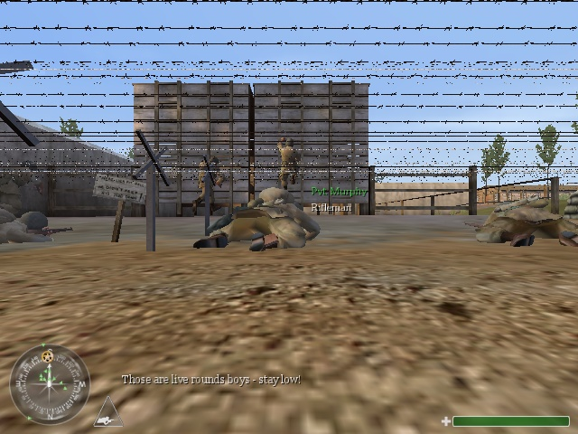

# Camp Toccoa, from the obstacle course to the first M1

[Русский](training.md)

After 196C we returned to the opening minutes of the American campaign. In Training, the recruits ahead of you show you how to clear the fence, where to go prone under the wire and where to run next. In the port they could reach the right spot without their movements showing how they got there.

## On the obstacle course

The recruits now vault over the low fence. The biggest change comes at the wire. A soldier used to slide along the ground almost to the ladder and snap upright at its foot. Now he gets to his feet as he clears the wire and runs the last stretch. At the ladder, he takes hold of the rungs, climbs and steps off at the top.

Captain Foley is worth a look while the recruits crawl. He walks alongside the wire, watching the group. He used to slide along the fence with both feet still. His stride now follows the distance he covers, and his feet come to rest when he stops.

## Loading and frame rate

Part of the wait for the diary came from preparing routes and repeatedly looking up data that was already loaded. After changes to both operations, the time from starting the map to seeing the diary fell from about 2 minutes 51 seconds to 1 minute 13 seconds on our Windows test system. Those figures compare two development builds. The original Call of Duty takes about 3.3 seconds on the same system.

During the exercise, the engine also does less repeated work updating the recruits. Two runs at 1280 × 800 averaged 55.5 and 56.7 FPS from the start to the first M1. Picking up the weapon at the rack now feels smooth. Dips are still noticeable earlier on, when the recruits bunch up on the course. The wire averaged 52–55 FPS and the ladder about 56. A steady 60 FPS throughout the course remains our target.

## The sound of the camp

You can now take your time reading the opening diary in quiet. The camp used to be audible on the diary screen and could fall silent just as you entered Camp Toccoa. Closing the diary brought the display clock back in sync with the paused mission clock. The sound system took that adjustment for a level restart.

Now the title music starts when you click through. You can hear the camp behind Foley as he speaks, and it stays audible after the music ends.
