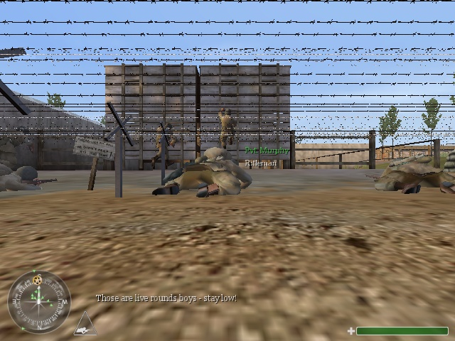

# Кэмп-Токкоа. От полосы препятствий до первого М1

[English](training.en.md)

После версии 196C мы вернулись к началу американской кампании. В первые минуты Training игрок почти всё время видит перед собой других курсантов. По ним можно понять, как взять забор, где лечь под проволокой и куда бежать дальше. В порте бойцы добирались до нужного места, но по их движениям не всегда было понятно, как они туда попали.

## На полосе препятствий

Курсанты теперь перемахивают через низкий забор. Самое заметное изменение ждёт у проволоки. Раньше боец мог скользить по земле почти до самой лестницы, а у подножия мгновенно оказаться на ногах. Теперь он поднимается, когда выбирается из-под проволоки, и последние метры до лестницы пробегает. Затем берётся за перекладины, поднимается и перебирается через верхний край.

У проволоки стоит посмотреть и в сторону капитана Фоули. Пока курсанты ползут, он идёт рядом и следит за группой. Раньше капитан мог скользить вдоль ограждения с неподвижными ногами. Теперь длина его шага связана с пройденным расстоянием, и на остановке он перестаёт шагать.

## Время загрузки и частота кадров

Часть ожидания перед дневником уходила на подготовку маршрутов и повторный поиск уже загруженных данных. После переработки этих операций время от запуска учебной карты до появления дневника на тестовой системе под Windows сократилось примерно с 2 минут 51 секунды до 1 минуты 13 секунд. Это сравнение двух сборок в ходе разработки. У оригинальной Call of Duty на той же системе этот переход занимает около 3,3 секунды.

Во время самого упражнения движок теперь реже пересчитывает одно и то же состояние бойцов. В двух прохождениях при 1280 × 800 средняя частота кадров от старта до первого М1 составила 55,5 и 56,7 кадра/с. Сама стойка с оружием уже проходится плавно. Просадки всё ещё заметны раньше, когда на полосе собирается вся группа. У проволоки получилось в среднем 52–55 кадров/с, у лестницы — около 56. Цель в 60 кадров/с на всём маршруте ещё впереди.

## Звуки лагеря

Дневник в начале миссии теперь можно читать в тишине. Раньше шум лагеря начинался уже на странице дневника и мог оборваться как раз тогда, когда игрок попадал в Кэмп-Токкоа. Причина была в паузе. Когда игрок закрывал дневник, движок подстраивал часы изображения под время миссии, а звуковая система принимала эту поправку за перезапуск уровня.

Теперь после щелчка по странице вступает музыка титров. На уровне шум лагеря слышен за голосом Фоули и остаётся, когда музыка стихает.
